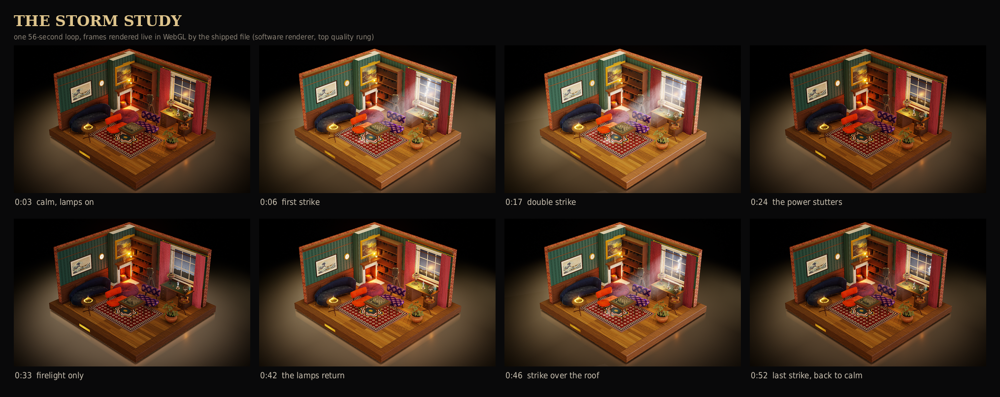

# The Storm Study

A photoreal, endlessly looping diorama: an aviator's study during a thunderstorm and a power cut, drawn live in WebGL on a glossy display table.
Real scanned-quality models (CC0 / CC BY glTF sample assets), real oil-painting reproductions, physically based materials, soft ray-marched light shafts,
real glass and a window that shows the storm outside. No people, no low-poly stand-ins.



* One 56-second loop that closes seamlessly (frame 0 is frame 56). Everything that moves is a pure function of the loop clock.
* Six lightning flashes (6.2 s, 16.4 s, 16.95 s, 29.8 s, 46.3 s, 51.6 s) light the room through the window bars; at 23 s the lamps stutter out, the room
  lives on firelight until 41 s, then the power returns by 42.6 s.
* Little things happen in the room: steam off the tea, sparks from the coals, dust turning in the light, a barometer needle that flinches at each strike, the
  watch hands, and a chess game that plays itself (four knights hop out and home again, so the board ends the loop as it began).

## Run it

Open **`storm-study.html`** in any current browser. It is one self-contained file (about 34 MB): models, textures and the HDR environment are embedded, so it
works offline and from `file://`. The first moments compile shaders; a progress bar shows loading.

| Input | Action |
|---|---|
| mouse wheel / pinch | zoom up to 4.5x |
| drag | move the frame when zoomed |
| double-click / double-tap | reset the view |
| `Q` | lock maximum quality (press again for automatic) |
| `Space` / tap | with *reduced motion* on: the study opens on a still frame mid-flash; this starts and stops the loop |

Quality adapts on its own (`src/core/governor.js`): the picture never renders below the screen's native pixel ratio; when a machine struggles the effects go
first (supersampling, glow, ambient occlusion, real glass, shadow size, light shafts), not the sharpness, and it climbs back when frames allow.

### URL parameters

`?t=6.2` freeze at a time · `?from=20` start the loop at a time · `?q=0..5` force a rung (eco/lite/medium/high/ultra/max, where the screen has them) ·
`?dpr=2` force the pixel ratio · `?ss=1.5` force supersampling · `?bloom=0` `?ao=0` `?vol=0` switch an effect off · `?sharp=0..1` sharpening ·
`?qa=1` the headless-check mode used by `qa/` (top rung, no governor, drawing buffer kept).

## Build

```
npm install
node tools/textures.mjs          # procedural PBR texture maps -> assets/tex (WebP)
node tools/optimize.mjs          # assets-raw/*.glb -> assets/glb (WebP textures, quantised + meshopt, logos painted out)
node build.mjs                   # dist/app.js, index.html, storm-study.html (everything embedded); add --no-standalone to skip the big file
```

`index.html` loads `dist/app.js` and the loose files in `assets/`; `storm-study.html` carries the same files base64-embedded in `window.__PAK`.
`dist/storm-study.artifact.html` is the page-only build for hosting the assets as separate files.

The published artifact uses that page-only build. Its host serves only web file types, so the models and the HDR are published under a `.woff2` name (bytes
unchanged; the page appends the suffix, see `getBytes` in `src/core/pak.js`). The 17 models are published twice: meshopt-compressed (`assets/glb`, about 20 MB)
and plain (`assets/glbp`, about 31 MB), and the plain set is fetched instead only if the viewer refuses WebAssembly. First load is about 27 MB (about 38 MB on
the fallback path). `node tools/plain.mjs` writes the plain set; `node qa/stage.mjs` lays the published files out for a local test.

The raw models are the Khronos glTF Sample Assets (see `CREDITS.md`); `tools/gltf2glb.mjs` packs a folder glTF into a .glb.

## Checks (`qa/`)

Run against `index.html` in headless Chrome with a software GL (slow but deterministic).

| Script | What it does |
|---|---|
| `shoot.mjs` | frozen frames: `--views="6.24:;30:;3:2.4,0,0"` (time:zoom,cx,cy), `--vp=1280x800`, `--dsf=2`, `--q=q=3` |
| `seam.mjs` | loop-seam audit: every matrix, light, material and uniform at t=0 against t=56 |
| `governor-test.mjs` | simulated GPUs against the adaptive-quality controller |
| `reduced.mjs` | the reduced-motion behaviour (still frame, tap to start and stop) |
| `stage.mjs`, `serve.mjs` | lay out the published files and serve them with a strict Content-Security-Policy (`--csp=strict\|wasm\|none`), to try the fetch path and the no-WebAssembly fallback the way a host runs them |
| `sheet.py` | the captioned contact sheet of the loop's beats (`shots/beats-sheet.png`) |
| `eval.mjs`, `url.mjs` | run code in the page; build the check address |

## Layout

```
src/main.js            renderer, quality tiers, loop clock, input, __diorama (test hook)
src/config.js          loop length, room dimensions, camera, the lightning schedule (FLASH)
src/core/hq.js         render pipeline: MSAA -> SSAO -> volumetric light -> bloom -> grade (tone map, supersample, sharpen, vignette)
src/core/governor.js   quality ladder and adaptive controller
src/core/{pak,view,util}.js   asset packer/loader, zoom + pan, geometry helpers
src/scene/room.js      the cut-away room, plinth, table, painting, print, barometer
src/scene/props.js     the 17 models, their placement, glass switch, glow registry, ghost chess
src/scene/lighting.js  the light rig and the storm timeline
src/scene/storm.js     window shader (clouds, bolts, rain), particles, dust
src/scene/materials.js shared PBR materials
tools/                 texture generation, asset optimiser, inspectors
```

See `DESIGN.md` for the decisions behind it, `TODO.md` for what is left, and `CREDITS.md` for the assets and licences.
